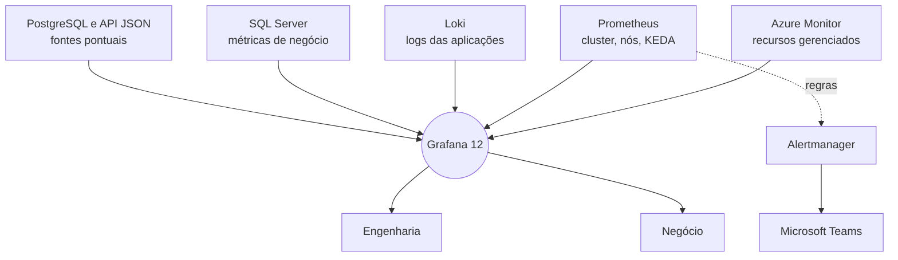

<ObsDecor :series-y="-80" />

<div class="relative z-10 h-full flex flex-col justify-between py-2">

<div class="eyebrow">DEVPIRA Grafana Day · Piracicaba-SP</div>

<div class="flex flex-col gap-6">
<h1 class="statement" style="font-size:4rem">Uma stack,<br>duas audiências</h1>
<div class="soft text-2xl">Grafana para a Engenharia e para o Negócio</div>
</div>

<div class="flex justify-between items-end">
<p class="text-xl font-semibold">Milton Camara</p>
<p class="mono soft text-sm">31 de outubro de 2026 · Faculdade Anhanguera</p>
</div>

</div>

<!--
Abertura. A promessa da palestra é simples: o mesmo Grafana atendendo engenharia e negócio, e principalmente o que esse Grafana esconde quando está mal configurado. Tudo que vou mostrar aconteceu numa plataforma de mensageria corporativa em produção.
-->

---
class: dark
---

<div class="h-full grid grid-cols-[1fr_2fr] gap-12 items-center">


<div class="flex flex-col gap-4">
<div class="eyebrow">Quem fala</div>
<h2 style="font-size:2.6rem">Milton Camara</h2>
<div class="text-xl">Principal Software Architect</div>
<div class="text-lg hl font-semibold">9x Microsoft MVP</div>
<div class="flex flex-col gap-1 mt-2">
<div class="soft text-lg">.NET, Azure, Kubernetes e DevOps</div>
<div class="soft text-lg">Sistemas Distribuídos, Event-Driven e Observabilidade</div>
<div class="soft text-lg">Applied AI (Agents, MCP)</div>
</div>
</div>

</div>

<!--
Apresentação rápida, no máximo trinta segundos. O foco é a experiência de campo, não o currículo.
-->

---
class: light
---

<h2>O mesmo sistema, duas perguntas</h2>

<div class="grid grid-cols-2 gap-8 mt-10">
<div class="card flex flex-col gap-4">
<div class="eyebrow blue">Engenharia</div>
<p class="text-2xl">O pod reiniciou?</p>
<p class="text-2xl">A fila represou?</p>
<p class="text-2xl">O disco vai encher?</p>
</div>
<div v-click class="card flex flex-col gap-4">
<div class="eyebrow">Operação e negócio</div>
<p class="text-2xl">As mensagens do cliente saíram?</p>
<p class="text-2xl">O SLA foi cumprido?</p>
<p class="text-2xl">A campanha rodou?</p>
</div>
</div>

<!--
A plataforma manda WhatsApp, SMS e RCS para empresas. A engenharia olha pod, fila e disco. A operação olha mensagem entregue, SLA e campanha. São perguntas legítimas sobre o mesmo sistema, mas com vocabulário diferente. Pergunte para a plateia de qual lado eles costumam estar.
-->

---
class: dark
---

<div class="h-full flex flex-col justify-center gap-8">
<h2 class="statement">2 ferramentas.<br>2 times.<br><span class="hl">2 versões da verdade.</span></h2>
<p v-click class="soft text-2xl">A proposta: um Grafana só. E saber o que ele esconde.</p>
</div>

<!--
O caminho natural é cada lado ter sua ferramenta. A engenharia com o stack de observabilidade, o negócio com relatório ou BI. Aí aparece a reunião em que um número não bate com o outro e ninguém sabe qual está certo. A ideia aqui é uma fonte de visualização só. Mas um painel unificado também unifica os erros, e essa é a segunda metade da palestra.
-->

---
class: light
---

<h2>A stack em três números</h2>

<div class="grid grid-cols-3 gap-10 mt-12">
<div>
<div class="big" style="font-size:8rem">9</div>
<p class="text-2xl font-semibold mt-2">datasources</p>
<p class="soft mt-2">duas assinaturas Azure, primário e réplica contam separado</p>
</div>
<div>
<div class="big" style="font-size:8rem">6</div>
<p class="text-2xl font-semibold mt-2">tecnologias</p>
<p class="soft mt-2">cada uma responde uma pergunta diferente</p>
</div>
<div>
<div class="big" style="font-size:8rem">1</div>
<p class="text-2xl font-semibold mt-2">painel</p>
<p class="soft mt-2">Grafana 12 self-hosted no AKS</p>
</div>
</div>

<!--
Grafana 12 self-hosted, instalado via kube-prometheus-stack dentro do AKS. Nove datasources porque algumas tecnologias aparecem mais de uma vez: Azure Monitor em duas assinaturas, SQL Server com primário e réplica. Seis tecnologias diferentes. Um lugar só para olhar.
-->

---
class: dark
---

<h2>De onde vem cada número</h2>

<div class="mt-6">



</div>

<!--
Por que não viraram seis ferramentas: porque o Grafana não armazena nada, ele só consulta. Cada fonte continua sendo a dona do seu dado. Azure Monitor para o que é gerenciado pelo Azure. Prometheus para o cluster. Loki para log de aplicação. SQL Server para o que o negócio pergunta. PostgreSQL e uma API JSON entram em casos pontuais. O Alertmanager fecha o ciclo mandando alerta para o Teams.
-->

---
class: light
---

<h2>Antes do painel: quem enxerga o quê</h2>

<div class="grid grid-cols-3 gap-6 mt-10">
<div class="card flex flex-col gap-3">
<carbon-locked class="text-4xl" style="color:var(--gd-accent)" />
<p class="text-2xl font-semibold">Só rede interna</p>
<p class="soft">Publicado atrás de VPN. Nada exposto na internet.</p>
</div>
<div class="card flex flex-col gap-3">
<carbon-password class="text-4xl" style="color:var(--gd-accent)" />
<p class="text-2xl font-semibold">Login via Entra ID</p>
<p class="soft">Sem usuário local para esquecer de desligar.</p>
</div>
<div class="card flex flex-col gap-3">
<carbon-user-multiple class="text-4xl" style="color:var(--gd-accent)" />
<p class="text-2xl font-semibold">Papéis por app role</p>
<p class="soft">A diretoria vê negócio. A engenharia vê tudo.</p>
</div>
</div>

<!--
Quando o negócio entra no mesmo Grafana, controle de acesso deixa de ser detalhe. O painel tem volume por cliente e limite contratual, isso é dado sensível. Grafana publicado só na rede interna atrás de VPN, autenticação via Entra ID e papéis mapeados por app role. Quem sai da empresa perde acesso ao Grafana junto com o resto.
-->

---
class: light
---

<div class="eyebrow blue">Camada técnica</div>
<h2 class="mt-2">Cada fonte responde uma pergunta</h2>

<div class="grid grid-cols-3 gap-6 mt-10">
<div class="card-top flex flex-col gap-3">
<p class="text-2xl font-semibold">Azure Monitor</p>
<p class="soft text-lg">O que o Azure gerencia: banco, fila, cache, rede.</p>
</div>
<div class="card-top flex flex-col gap-3">
<p class="text-2xl font-semibold">Prometheus</p>
<p class="soft text-lg">Cluster, nós, volumes e as métricas do KEDA.</p>
</div>
<div class="card-top flex flex-col gap-3">
<p class="text-2xl font-semibold">Loki</p>
<p class="soft text-lg">Log das aplicações que rodam no Kubernetes.</p>
</div>
</div>

<!--
Camada técnica. A regra que usamos: não duplicar coleta. Se o Azure já mede o recurso gerenciado, a gente consulta o Azure Monitor. Se o dado nasce no cluster, Prometheus. Se é o que a aplicação escreveu, Loki. Parece óbvio, mas no final da palestra mostro um caso em que essa regra estava sendo aplicada ao contrário.
-->

---
class: light
---

<div class="eyebrow blue">Camada técnica · Loki</div>
<h2 class="mt-2">Log útil é log estruturado</h2>

<div class="grid grid-cols-[2fr_3fr] gap-10 mt-8 items-center">
<div class="flex flex-col gap-5 text-xl">
<p><b>.NET com Serilog</b> escrevendo em CLEF</p>
<p><b>Nível normalizado</b> virou label consultável</p>
<p><b>trace_id</b> como structured metadata, não como label</p>
</div>
<div class="flex flex-col gap-3">

```json
{ "@t": "…", "@l": "Error",
  "@mt": "Falha ao enviar {MessageId}",
  "trace_id": "…" }
```

```
sum by (level) (
  count_over_time({app="envio"}[5m])
)
```

</div>
</div>

<!--
CLEF é o formato JSON compacto do Serilog. No CLEF o nível Information é omitido por padrão, então a pipeline de coleta precisa normalizar: ausência de @l vira info, e os outros níveis viram um label padronizado. O trace_id fica como structured metadata do Loki e não como label, porque como label ele explode a cardinalidade do índice. Com isso dá para contar erro por aplicação e ainda pular do log para o trace.
-->

---
class: light
---

<div class="eyebrow">Camada de negócio</div>
<h2 class="mt-2">O que a diretoria abre de manhã</h2>

<div class="grid grid-cols-3 gap-6 mt-10">
<div class="card-top biz flex flex-col gap-3">
<p class="text-2xl font-semibold">Volume por cliente</p>
<p class="soft text-lg">Quanto cada cliente enviou, por canal e por período.</p>
</div>
<div class="card-top biz flex flex-col gap-3">
<p class="text-2xl font-semibold">Represamento</p>
<p class="soft text-lg">Mensagem que entrou e ainda não foi entregue.</p>
</div>
<div class="card-top biz flex flex-col gap-3">
<p class="text-2xl font-semibold">Limite contratual</p>
<p class="soft text-lg">Consumo do mês contra o que foi contratado.</p>
</div>
</div>

<p class="mono soft text-sm mt-8">Fonte: SQL direto na base transacional</p>

<!--
Aqui não tem exporter nem métrica customizada. É consulta SQL direto na base, porque é lá que o dado de negócio já existe. A vantagem é que o número do painel é o mesmo número do faturamento. A desvantagem é óbvia: consulta pesada rodando contra a base de produção. O próximo slide é a decisão que resolve isso.
-->

---
class: dark
---

<div class="h-full flex flex-col justify-center gap-6">
<div class="eyebrow">Decisão de arquitetura</div>
<h2 class="statement">Consulta de negócio<br>vai na réplica.</h2>
<p v-click class="text-3xl font-semibold hl">Nunca no primário.</p>
</div>

<!--
Um painel com refresh automático aberto por dez pessoas é uma carga constante que ninguém planejou. Se essa carga cai no primário, o monitoramento passa a competir com o envio de mensagens. Por isso as consultas de negócio apontam para a réplica de leitura. O custo dessa decisão é o atraso de replicação, normalmente segundos. Para painel de negócio isso é aceitável. Para alerta crítico talvez não seja, e vale dizer isso em voz alta.
-->

---
class: accent
---

<div class="h-full flex flex-col justify-center gap-6">
<div class="eyebrow" style="color:#fbe3cc">O que mudou</div>
<h1 class="statement" style="font-size:4.4rem">Antes,<br>dois mundos.</h1>
<p class="text-2xl">Como a gente monitorava antes do Grafana.</p>
</div>

<!--
Até aqui mostrei como está hoje. Agora quero mostrar de onde a gente saiu, porque é isso que explica por que valeu a pena juntar tudo.
-->

---
class: light
---

<h2>Como era antes</h2>

<div class="grid grid-cols-2 gap-8 mt-10">
<div class="card flex flex-col gap-4">
<div class="eyebrow blue">Engenharia</div>
<p class="text-2xl font-semibold">Painéis no portal do Azure</p>
<p class="soft text-lg">A infraestrutura era acompanhada pelos painéis do próprio portal.</p>
</div>
<div class="card flex flex-col gap-4">
<div class="eyebrow">Negócio</div>
<p class="text-2xl font-semibold">Aplicações próprias lendo o banco</p>
<p class="soft text-lg">Cada métrica de negócio exigia código escrito, publicado e mantido.</p>
</div>
</div>

<div v-click class="text-2xl font-semibold mt-10">Cada pergunta tinha um lugar diferente para olhar.</div>

<!--
Antes, a engenharia acompanhava a infraestrutura pelos painéis do portal do Azure. Já as métricas de negócio, como volume por cliente e represamento, não estavam em painel nenhum: a gente criava aplicações separadas que liam o banco e mostravam os números. Cada métrica nova era código novo, deploy novo e mais uma aplicação para manter funcionando. E quem precisava cruzar as duas coisas tinha que abrir as duas.
-->

---
class: dark
---

<div class="h-full flex flex-col justify-center gap-8">
<h2 class="statement">Métrica de negócio nova<br>era aplicação nova.</h2>
<p v-click class="text-4xl font-semibold hl">Hoje é uma consulta.</p>
</div>

<!--
Esse é o ganho que mais aparece no dia a dia. Antes, para a diretoria ver um número novo, alguém tinha que escrever, publicar e manter uma aplicação. Hoje é uma consulta SQL num painel do Grafana, apontando para a réplica. Menos código para manter e o número fica do lado das métricas técnicas.
-->

---
class: light
---

<h2>Hoje: tudo no Grafana</h2>

<div class="grid grid-cols-4 gap-5 mt-10">
<div class="card-top flex flex-col gap-3">
<p class="text-2xl font-semibold">Dashboards</p>
<p class="soft">Azure Monitor, Prometheus e SQL lado a lado no mesmo painel.</p>
</div>
<div class="card-top flex flex-col gap-3">
<p class="text-2xl font-semibold">Logs</p>
<p class="soft">Loki com LogQL, no mesmo intervalo de tempo do gráfico.</p>
</div>
<div class="card-top flex flex-col gap-3">
<p class="text-2xl font-semibold">Alertas</p>
<p class="soft">Regras de alerta entregues no Teams pelo Alertmanager.</p>
</div>
<div class="card-top flex flex-col gap-3">
<p class="text-2xl font-semibold">Acesso</p>
<p class="soft">Entra ID e papéis por app role. Um login só.</p>
</div>
</div>

<!--
Hoje está tudo num lugar só. Dashboards que juntam Azure Monitor, Prometheus e SQL no mesmo painel. Logs no Loki, consultados com LogQL ao lado do gráfico. Alertas entregues no Teams pelo Alertmanager. E um único controle de acesso, pelo Entra ID. Não é só conveniência: quando o volume de um cliente cai, dá para olhar o log de erro e o alerta no mesmo intervalo de tempo, sem trocar de ferramenta.
-->

---
class: dark
---

<div class="h-full flex flex-col justify-center gap-6">
<div class="eyebrow">O outro lado</div>
<h2 class="statement">Um lugar só para olhar<br>também é um lugar só<br><span class="hl">para errar.</span></h2>
</div>

<!--
Juntar tudo tem um custo que pouca gente comenta. Se uma fonte para de mandar dado, o painel não fica vermelho, ele simplesmente fica quieto. E ausência de sinal não é ausência de problema. Por isso, junto com a migração, a gente precisou de práticas para garantir que o painel mede de verdade.
-->

---
class: light
---

<h2>Como saber se o monitoramento mede de verdade</h2>

<div class="grid grid-cols-2 gap-5 mt-8">
<div v-click class="card flex flex-col gap-2">
<p class="text-xl font-semibold">Alerte a ausência</p>
<p class="mono text-sm" style="color:var(--gd-accent)">absent(kubelet_volume_stats_used_bytes)</p>
</div>
<div v-click class="card flex flex-col gap-2">
<p class="text-xl font-semibold">Exija o sinal de vida</p>
<p class="soft">Um alerta que sempre dispara. Se ele parar de chegar, o caminho quebrou.</p>
</div>
<div v-click class="card flex flex-col gap-2">
<p class="text-xl font-semibold">Quebre de propósito</p>
<p class="soft">Injete um erro conhecido e confira se ele chega ao painel como erro.</p>
</div>
<div v-click class="card flex flex-col gap-2">
<p class="text-xl font-semibold">Monitore o monitor</p>
<p class="soft">Coletor, agente e Alertmanager também falham. E também expõem métricas.</p>
</div>
</div>

<!--
Quatro práticas para garantir que o painel unificado mede de verdade. Primeira: para cada métrica de que um alerta depende, um alerta de ausência com a função absent do PromQL. Se a métrica some, alguém fica sabendo. Segunda: um alerta que dispara sempre, como o Watchdog do kube-prometheus-stack, com algo do lado de fora avisando quando ele para de chegar. Terceira: depois de toda mudança na pipeline de coleta, gerar um erro conhecido e conferir se ele aparece como erro. Quarta: o coletor, o agente e o Alertmanager expõem métricas de descarte e falha. Olhe para elas.
-->

---
class: light
---

<div class="eyebrow">Profundidade de fila</div>
<h2 class="mt-2">A fonte mais rápida já estava no cluster</h2>

<div class="grid grid-cols-2 gap-6 mt-8">
<div class="card flex flex-col gap-2 justify-center">
<p class="mono soft font-semibold">Azure Monitor</p>
<p class="soft" style="font-size:4.4rem;font-weight:600;line-height:1">minutos</p>
<p class="soft text-lg">de atraso entre a fila encher e o painel mostrar</p>
</div>
<div v-click class="flex flex-col gap-2 justify-center rounded-xl p-6" style="background:var(--gd-dark);color:var(--gd-light)">
<p class="mono font-semibold" style="color:var(--gd-accent-dark)">KEDA</p>
<p style="font-size:4.4rem;font-weight:600;line-height:1">30 s</p>
<p class="text-lg" style="color:var(--gd-soft-dark)">já lendo a mesma fila para escalar, e publicando como métrica Prometheus</p>
</div>
</div>

<div class="footnote">Sem custo adicional. Só faltava olhar para ela.</div>

<!--
Fechamento. A profundidade de fila no painel vinha do Azure Monitor, com alguns minutos de atraso. Enquanto isso o KEDA, que já estava no cluster, lia exatamente a mesma fila a cada 30 segundos, que é o intervalo padrão de polling dele, para decidir quantos workers subir. E o operador do KEDA já publica esse valor como métrica Prometheus. A informação mais rápida e mais barata estava ali o tempo todo. Lembra da regra de não duplicar coleta? Ela estava certa, a gente só estava escolhendo a fonte errada.
-->

---
class: light
---

<div class="eyebrow">Fila do Cliente A</div>

<div class="grid grid-cols-[1fr_auto_1fr] gap-10 items-center mt-10">
<div>
<div class="big" style="font-size:6.5rem">~4 mil</div>
<p class="soft text-xl mt-2">mensagens represadas</p>
</div>
<p class="soft text-3xl">vs</p>
<div>
<div class="big" style="font-size:6.5rem;color:var(--gd-ink)">2</div>
<p class="soft text-xl mt-2">workers com réplica fixa</p>
</div>
</div>

<p v-click class="text-3xl font-semibold mt-12">O painel mediu o problema. Não resolveu.</p>

<!--
E o último caso fecha o raciocínio. Uma fila de um cliente com quase 4 mil mensagens represadas, sendo atendida por 2 workers com número fixo de réplicas. O painel mostrava isso com perfeição. Mas medir não é resolver. Aquele worker precisava escalar pela própria fila, que é exatamente o que o KEDA já fazia para outros workers. Observabilidade boa termina em ação, não em gráfico bonito.
-->

---
class: accent
---

<div class="h-full flex flex-col justify-center gap-6">
<div class="eyebrow" style="color:#fbe3cc">Depois do painel</div>
<h1 class="statement" style="font-size:4.4rem">Do alerta<br>ao diagnóstico.</h1>
<p class="text-2xl">Um agente de IA que investiga o banco quando o alerta dispara.</p>
</div>

<!--
Observabilidade boa termina em ação. O passo seguinte que demos foi este: quando um alerta crítico do banco dispara, um agente de IA investiga o banco na hora e entrega um laudo no mesmo canal do alerta. Ele não substitui ninguém e não executa nada: ele faz os primeiros dez minutos de investigação que alguém faria abrindo o notebook às seis da tarde. Vou mostrar como ele coleta, como ele entra no banco, como é o harness em volta do modelo e onde entram os MCPs.
-->

---
class: dark
---

<h2>O caminho do alerta</h2>

<div class="flow mt-10 flex flex-col gap-7">
<div class="flex items-center gap-3">
<span class="lane">Observar</span>
<span class="node">Banco<br><small>procedures só leitura</small></span><span class="arr">→</span>
<span class="node">Coletor<br><small>/metrics</small></span><span class="arr">→</span>
<span class="node">Prometheus</span><span class="arr">→</span>
<span class="node">Grafana</span>
</div>
<div class="flex items-center gap-3">
<span class="lane">Alertar</span>
<span class="node">Regras</span><span class="arr">→</span>
<span class="node">Alertmanager</span><span class="arr">→</span>
<span class="node">Microsoft Teams</span>
</div>
<div class="flex items-center gap-3">
<span class="lane hl">Investigar</span>
<span class="node">Webhook</span><span class="arr">→</span>
<span class="node hot">Agente de diagnóstico</span><span class="arr">⇄</span>
<span class="node">LLM</span><span class="arr">+</span>
<span class="node">Ferramentas<br><small>banco · APM · código</small></span><span class="arr">→</span>
<span class="node hot">Laudo no Teams</span>
</div>
</div>

<style>
.flow .lane { width: 7.5rem; font-family: 'JetBrains Mono', monospace; font-size: 0.75rem; font-weight: 600; letter-spacing: 0.12em; text-transform: uppercase; color: var(--gd-soft-dark); }
.flow .lane.hl { color: var(--gd-accent-dark); }
.flow .node { border: 1px solid #3a4250; border-radius: 10px; padding: 0.55rem 0.9rem; font-size: 1.05rem; line-height: 1.2; text-align: center; }
.flow .node small { color: var(--gd-soft-dark); font-size: 0.75rem; }
.flow .node.hot { border-color: var(--gd-accent-dark); color: var(--gd-accent-dark); font-weight: 600; }
.flow .arr { color: var(--gd-soft-dark); font-size: 1.2rem; }
</style>

<!--
O desenho cabe num slide. Um coletor lê o banco e expõe as métricas no formato Prometheus. O Prometheus raspa, o Grafana mostra e as regras avaliam. Quando uma regra crítica do banco dispara, o Alertmanager manda para o Teams, como sempre, e também chama um webhook do agente. O agente então conversa com o modelo e usa ferramentas: as mesmas procedures do banco, o APM para saber se o cliente está sentindo e a busca no código-fonte para achar de onde vem a consulta. O laudo volta para o mesmo canal do alerta. Repare que o agente reaproveita a stack inteira que mostrei antes: nada foi construído do lado.
-->

---
class: light
---

<div class="eyebrow blue">Agente · Coleta</div>

<div class="grid grid-cols-[2fr_3fr] gap-12 items-center mt-10">
<div>
<div class="big">18 ms</div>
<p class="soft text-lg mt-3">por coleta. Uma procedure, várias grades de resultado.</p>
</div>
<div class="flex flex-col gap-5">
<div><div class="label">O que mede</div><p class="text-xl mt-1">CPU, workers, sessões, fila de bloqueio, bloqueador ocioso, log de transação, esperas.</p></div>
<div><div class="label">Como</div><p class="text-xl mt-1">Cerca de 40 séries, com rótulos de lista fechada. Nenhum rótulo vem de texto livre do banco.</p></div>
<div><div class="label accent">Regra da casa</div><p class="text-xl mt-1 font-semibold">O coletor é o primeiro a ser monitorado.</p></div>
</div>
</div>

<div class="footnote">Métrica de saúde da coleta + absent(): coleta que para também alerta</div>

<!--
O coletor é um processo .NET pequeno. A cada raspagem do Prometheus ele chama uma única procedure no banco, que devolve várias grades de resultado: recursos, requisições, bloqueio, log de transação e esperas. Leva 18 milissegundos. Rótulo de lista fechada é para não repetir o erro de cardinalidade: nenhum rótulo é texto que vem do banco, como nome de consulta ou de login. E aplicamos no próprio coletor a regra de monitorar o monitor: existe uma métrica de saúde da coleta e um alerta de ausência. Se o coletor parar, alguém fica sabendo. Ele só registra log quando falha ou quando volta, coleta com sucesso é silenciosa.
-->

---
class: light
---

<div class="eyebrow blue">Agente · Acesso ao banco</div>

<div class="grid grid-cols-[2fr_3fr] gap-12 items-center mt-10">
<div>
<div class="big">0</div>
<p class="soft text-lg mt-3">senhas de banco. Nem no código, nem no cofre.</p>
</div>
<div class="flex flex-col gap-5">
<div><div class="label">Identidade</div><p class="text-xl mt-1">O pod troca a identidade da carga por um token do Entra ID.</p></div>
<div><div class="label">Permissão</div><p class="text-xl mt-1">Só EXECUTE num schema próprio de procedures de leitura. Tabela de negócio: acesso negado.</p></div>
<div><div class="label accent">Antes do modelo</div><p class="text-xl mt-1 font-semibold">Literais e segredos saem do texto SQL.</p></div>
</div>
</div>

<div class="footnote">Timeout de 20 s volta para o modelo como evidência, não como erro</div>

<!--
Esse é o slide que o pessoal de segurança pergunta. O agente não tem usuário e senha. O pod usa Workload Identity: a service account do Kubernetes é federada com uma identidade gerenciada, que pega um token do Entra ID, e o banco aceita esse token. No banco, o usuário dessa identidade só pode executar procedures de um schema próprio, todas de leitura de DMV. Testamos com EXECUTE AS: ler tabela de cliente dá acesso negado. Antes de qualquer texto ir para o modelo, um filtro tira os literais do SQL, que podem ter dado pessoal, e qualquer coisa com cara de segredo. As procedures rodam com plano fixo e MAXDOP 1, para não competir com a carga que estão investigando. E se o banco não responder em 20 segundos, isso volta para o modelo como evidência: num dos incidentes, até a investigação ficou na fila de compilação, e isso dizia muito sobre o problema.
-->

---
class: light
---

<div class="eyebrow blue">Agente · Harness</div>
<h2 class="mt-2">O modelo decide o que olhar.<br>O código decide o que ele pode.</h2>

<div class="grid grid-cols-5 gap-3 mt-8">
<div class="card-top flex flex-col gap-2">
<p class="label">1 · Portão</p>
<p class="text-base">Só alerta crítico. 1 por alerta a cada 30 min, 4 por hora, 20 por dia.</p>
</div>
<div class="card-top flex flex-col gap-2">
<p class="label">2 · Contexto</p>
<p class="text-base">Princípios e playbooks dos incidentes anteriores.</p>
</div>
<div class="card-top flex flex-col gap-2">
<p class="label">3 · Ferramentas</p>
<p class="text-base">Catálogo fechado: 12 de leitura e 1 de entrega.</p>
</div>
<div class="card-top flex flex-col gap-2">
<p class="label">4 · Laudo</p>
<p class="text-base">Formato validado: severidade, ação, o que não foi verificado.</p>
</div>
<div class="card-top biz flex flex-col gap-2">
<p class="label accent">5 · Pessoa</p>
<p class="text-base font-semibold">Quem executa a ação é sempre gente.</p>
</div>
</div>

<div class="footnote">≈ 45 s e ≈ US$ 0,20 por diagnóstico · regressão com fotos de incidentes reais, às cegas</div>

<!--
Harness é tudo que fica em volta do modelo, e é onde está a maior parte do trabalho. Primeiro um portão: só alerta crítico do banco, com teto de custo, um diagnóstico por vez. Depois o contexto: um prompt de sistema com princípios aprendidos nos incidentes e um playbook por incidente anterior. Aí o modelo entra num laço de tool use, com no máximo 15 rodadas e 5 minutos: ele escolhe quais ferramentas chamar, de um catálogo fechado que a gente escreveu. Nenhuma ferramenta escreve nada. O laço só termina quando o modelo entrega o laudo pela ferramenta de entrega, num formato validado: severidade, confiança, incidente parecido, ação imediata e uma seção obrigatória do que ele não conseguiu verificar. O laudo vira um card no Teams. O modelo hoje é o Claude, pela API da Anthropic, mas a camada de provedor é trocável. E o mais importante: tratamos o agente como código. Cada incidente vira uma foto, com os dados reais daquele momento, e a regressão roda o agente nessas fotos às cegas, com o playbook do próprio incidente escondido.
-->

---
class: light
---

<div class="eyebrow">30/10, 18h46 · O agente em produção</div>

<div class="grid grid-cols-[2fr_3fr] gap-12 items-center mt-10">
<div>
<div class="big">966</div>
<p class="soft text-lg mt-3">requisições disputando a mesma linha do banco.</p>
</div>
<div class="flex flex-col gap-5">
<div><div class="label">Acertou</div><p class="text-xl mt-1">Não há bloqueador ocioso. Não mate sessão, não escale: o gargalo é o lock, não a CPU.</p></div>
<div><div class="label">Errou</div><p class="text-xl mt-1">“Nenhum incidente parecido.” O mesmo tinha acontecido na véspera.</p></div>
<div><div class="label accent">Lição</div><p class="text-xl mt-1 font-semibold">O agente só lembra do que alguém escreveu.</p></div>
</div>
</div>

<div class="footnote">O playbook do incidente da véspera foi escrito na mesma noite</div>

<!--
Caso de 30 de outubro, véspera desta palestra, no fim da tarde. Alerta de bloqueio persistente às 18h46. O laudo chegou no canal: quase mil requisições do serviço de chatbot disputando o mesmo UPDATE, numa única linha do cadastro de um cliente. Ele acertou o que mais importa no calor do momento: todos os bloqueadores estavam rodando, nenhum ocioso com transação esquecida, então matar sessão só passa o lock para a próxima da fila, e a CPU estava em 44%, então escalar não resolve. Ele também apontou o risco real, que era esgotar os workers do banco. Mas errou numa coisa: disse que não havia incidente parecido. Tinha, na véspera, mesma assinatura, mesmo cliente. Só que ninguém tinha escrito o playbook. A ferramenta não mostra o recurso do lock, então quem confirmou qual cliente era foi uma pessoa, rodando um script de leitura. O playbook foi escrito na mesma noite. É o tema desta palestra de novo: o agente não sabe o que ele não sabe.
-->

---
class: dark
---

<div class="eyebrow">Investigação interativa · MCP</div>
<h2 class="mt-2">Na investigação, a IA conversa com as mesmas fontes</h2>

<div class="grid grid-cols-3 gap-6 mt-10">
<div class="flex flex-col gap-2 pt-4" style="border-top:2px solid #3a4250">
<p class="text-2xl font-semibold">Grafana</p>
<p class="soft text-lg">PromQL, LogQL, painéis e regras de alerta.</p>
</div>
<div class="flex flex-col gap-2 pt-4" style="border-top:2px solid #3a4250">
<p class="text-2xl font-semibold">APM</p>
<p class="soft text-lg">O cliente está sentindo? Latência e erro por minuto.</p>
</div>
<div class="flex flex-col gap-2 pt-4" style="border-top:2px solid #3a4250">
<p class="text-2xl font-semibold">Azure DevOps</p>
<p class="soft text-lg">Código, cards e pull requests.</p>
</div>
</div>

<p v-click class="text-2xl font-semibold hl mt-12">A IA consulta e propõe. No banco, quem executa é a pessoa.</p>

<!--
O agente automático usa ferramentas fixas, escritas em código, porque roda sozinho às seis da tarde. Na investigação com alguém do lado o desenho é outro: um assistente de código com servidores MCP. O MCP do Grafana dá acesso ao Prometheus, ao Loki, aos painéis e às regras de alerta. Foi por ele que conferimos ontem a fila caindo minuto a minuto. O do APM responde se o cliente está sentindo. O do Azure DevOps acha o código, abre o card e o pull request. A regra que a gente segue: a IA consulta e propõe, mas no banco de produção ela não executa nada, nem leitura. Ela entrega o script e uma pessoa roda. Ontem o script que confirmou o cliente foi escrito pela IA e executado por gente.
-->

---
class: light
---

<div class="eyebrow blue">Próximo passo · O cluster</div>
<h2 class="mt-2">Mesmo harness, outro catálogo de ferramentas</h2>

<div class="grid grid-cols-4 gap-5 mt-10">
<div class="card-top flex flex-col gap-2">
<p class="text-xl font-semibold">Prometheus</p>
<p class="soft">Consultas fixas: reinício, rollout parado, volume, fila do KEDA.</p>
</div>
<div class="card-top flex flex-col gap-2">
<p class="text-xl font-semibold">Loki</p>
<p class="soft">Erro por aplicação e padrões de log, janela curta.</p>
</div>
<div class="card-top flex flex-col gap-2">
<p class="text-xl font-semibold">API do Kubernetes</p>
<p class="soft">Só leitura: eventos, pods, deployments. Sem acesso a Secret.</p>
</div>
<div class="card-top flex flex-col gap-2">
<p class="text-xl font-semibold">GitOps</p>
<p class="soft">O que mudou no cluster e quando.</p>
</div>
</div>

<p v-click class="text-2xl font-semibold mt-12">Os incidentes do cluster viram os primeiros playbooks.</p>

<!--
O próximo passo é levar o mesmo agente para o cluster. O harness não muda: portão, contexto, catálogo fechado, laudo validado, pessoa no final. O que muda é o catálogo. Consultas fixas de Prometheus para o que mais aparece: pod reiniciando, rollout que não progride, volume enchendo, fila do KEDA. Loki com janela curta, porque log é caro de consultar. API do Kubernetes com uma service account só de leitura, que não lê Secret. E o histórico do GitOps, que no cluster faz o papel que as mudanças recentes fazem no banco: o que mudou e quando. Parte disso pode vir do próprio MCP do Grafana, desde que a lista de consultas continue fechada. E os incidentes que já tivemos no cluster viram os primeiros playbooks. Isto ainda está em construção, não está em produção.
-->

---
class: dark
---

<div class="h-full flex flex-col justify-center gap-8">
<div class="eyebrow">A primeira regra do prompt</div>
<h2 class="statement">Campo nulo é<br>“não medido”.<br><span class="hl">Nunca “tudo bem”.</span></h2>
</div>

<!--
Para fechar o bloco do agente, a regra que mais pesou no prompt dele é exatamente a tese desta palestra. Campo nulo significa não medido, não zero e não "não aconteceu". O agente não pode afirmar nada a partir de um dado ausente, e tem que listar o que não conseguiu medir no laudo. Nos primeiros testes o modelo afirmou que o banco tinha reiniciado a partir de um campo vazio. Foi a mesma armadilha do painel verde, agora dentro de um modelo de linguagem. Se a máquina precisa dessa regra escrita, a gente também precisa.
-->

---
class: dark
---

<div class="h-full flex flex-col justify-center gap-10">
<h2 class="statement">Questione a própria<br>fonte de dados.</h2>
<div class="grid grid-cols-3 gap-6">
<p v-click class="text-xl hl pt-4" style="border-top:2px solid #3a4250">De onde vem esse número?</p>
<p v-click class="text-xl hl pt-4" style="border-top:2px solid #3a4250">Com quanto atraso ele chega?</p>
<p v-click class="text-xl hl pt-4" style="border-top:2px solid #3a4250">O que acontece se ele sumir?</p>
</div>
</div>

<!--
Três perguntas para levar para casa e fazer para cada painel. De onde vem esse número. Com quanto atraso ele chega. E a mais importante: o que acontece se ele sumir. Se a resposta da terceira for nada, o painel continua verde, então você tem um problema esperando para acontecer.
-->

---
class: dark
---

<ObsDecor :panels-y="34" />

<div class="relative z-10 h-full grid grid-cols-[3fr_2fr] gap-12 items-center">

<div class="flex flex-col gap-6">
<div class="eyebrow">Perguntas</div>
<h1 class="statement" style="font-size:5rem">Obrigado.</h1>
<div class="flex items-center gap-4">

<div>
<p class="text-xl font-semibold">Milton Camara</p>
<p class="mono soft text-sm">linkedin.com/in/miltoncamara</p>
</div>
</div>
</div>

<div class="grid grid-cols-2 gap-6">
<div class="flex flex-col items-center gap-3">

<p class="mono soft text-sm">Slides</p>
</div>
<div class="flex flex-col items-center gap-3">

<p class="mono soft text-sm">LinkedIn</p>
</div>
</div>

</div>

<!--
Agradecer, abrir para perguntas. Deixar esse slide parado durante as perguntas: um QR Code leva aos slides publicados e o outro ao LinkedIn. Se sobrar tempo, perguntar quantos na plateia já tiveram um alerta que deveria ter disparado e não disparou.
-->
