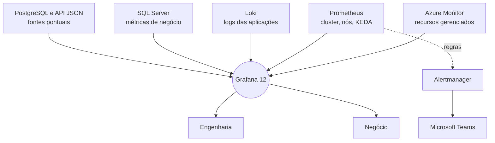

<ObsDecor :series-y="-80" />

<div class="relative z-10 h-full flex flex-col justify-between py-2">

<div class="eyebrow">DEVPIRA Grafana Day · Piracicaba-SP</div>

<div class="flex flex-col gap-6">
<h1 class="statement" style="font-size:4rem">Uma stack,<br>duas audiências</h1>
<div class="soft text-2xl">Grafana para a Engenharia e para o Negócio</div>
</div>

<div class="flex justify-between items-end">
<p class="text-xl font-semibold">Milton Camara</p>
<p class="mono soft text-sm">31 de outubro de 2026 · Faculdade Anhanguera</p>
</div>

</div>

<!--
Abertura. A promessa da palestra é simples: o mesmo Grafana atendendo engenharia e negócio, e principalmente o que esse Grafana esconde quando está mal configurado. Tudo que vou mostrar aconteceu numa plataforma de mensageria corporativa em produção.
-->

---
class: dark
---

<div class="h-full grid grid-cols-[1fr_2fr] gap-12 items-center">


<div class="flex flex-col gap-4">
<div class="eyebrow">Quem fala</div>
<h2 style="font-size:2.6rem">Milton Camara</h2>
<p class="text-xl">Principal Software Architect</p>
<p class="soft text-lg">Microsoft MVP em DevOps · Microsoft Certified Trainer</p>
<p class="soft text-lg">Cofundador da comunidade Azure na Prática</p>
<p class="mono soft text-sm mt-2">.NET · Azure · Kubernetes · Observabilidade</p>
</div>

</div>

<!--
Apresentação rápida, no máximo trinta segundos. O foco é a experiência de campo, não o currículo.
-->

---
class: light
---

<h2>O mesmo sistema, duas perguntas</h2>

<div class="grid grid-cols-2 gap-8 mt-10">
<div class="card flex flex-col gap-4">
<div class="eyebrow blue">Engenharia</div>
<p class="text-2xl">O pod reiniciou?</p>
<p class="text-2xl">A fila represou?</p>
<p class="text-2xl">O disco vai encher?</p>
</div>
<div v-click class="card flex flex-col gap-4">
<div class="eyebrow">Operação e negócio</div>
<p class="text-2xl">As mensagens do cliente saíram?</p>
<p class="text-2xl">O SLA foi cumprido?</p>
<p class="text-2xl">A campanha rodou?</p>
</div>
</div>

<!--
A plataforma manda WhatsApp, SMS e RCS para empresas. A engenharia olha pod, fila e disco. A operação olha mensagem entregue, SLA e campanha. São perguntas legítimas sobre o mesmo sistema, mas com vocabulário diferente. Pergunte para a plateia de qual lado eles costumam estar.
-->

---
class: dark
---

<div class="h-full flex flex-col justify-center gap-8">
<h2 class="statement">2 ferramentas.<br>2 times.<br><span class="hl">2 versões da verdade.</span></h2>
<p v-click class="soft text-2xl">A proposta: um Grafana só. E saber o que ele esconde.</p>
</div>

<!--
O caminho natural é cada lado ter sua ferramenta. A engenharia com o stack de observabilidade, o negócio com relatório ou BI. Aí aparece a reunião em que um número não bate com o outro e ninguém sabe qual está certo. A ideia aqui é uma fonte de visualização só. Mas um painel unificado também unifica os erros, e essa é a segunda metade da palestra.
-->

---
class: light
---

<h2>A stack em três números</h2>

<div class="grid grid-cols-3 gap-10 mt-12">
<div>
<div class="big" style="font-size:8rem">9</div>
<p class="text-2xl font-semibold mt-2">datasources</p>
<p class="soft mt-2">duas assinaturas Azure, primário e réplica contam separado</p>
</div>
<div>
<div class="big" style="font-size:8rem">6</div>
<p class="text-2xl font-semibold mt-2">tecnologias</p>
<p class="soft mt-2">cada uma responde uma pergunta diferente</p>
</div>
<div>
<div class="big" style="font-size:8rem">1</div>
<p class="text-2xl font-semibold mt-2">painel</p>
<p class="soft mt-2">Grafana 12 self-hosted no AKS</p>
</div>
</div>

<!--
Grafana 12 self-hosted, instalado via kube-prometheus-stack dentro do AKS. Nove datasources porque algumas tecnologias aparecem mais de uma vez: Azure Monitor em duas assinaturas, SQL Server com primário e réplica. Seis tecnologias diferentes. Um lugar só para olhar.
-->

---
class: dark
---

<h2>De onde vem cada número</h2>

<div class="mt-6">



</div>

<!--
Por que não viraram seis ferramentas: porque o Grafana não armazena nada, ele só consulta. Cada fonte continua sendo a dona do seu dado. Azure Monitor para o que é gerenciado pelo Azure. Prometheus para o cluster. Loki para log de aplicação. SQL Server para o que o negócio pergunta. PostgreSQL e uma API JSON entram em casos pontuais. O Alertmanager fecha o ciclo mandando alerta para o Teams. Guarde esse Alertmanager, ele volta num dos casos.
-->

---
class: light
---

<h2>Antes do painel: quem enxerga o quê</h2>

<div class="grid grid-cols-3 gap-6 mt-10">
<div class="card flex flex-col gap-3">
<carbon-locked class="text-4xl" style="color:var(--gd-accent)" />
<p class="text-2xl font-semibold">Só rede interna</p>
<p class="soft">Publicado atrás de VPN. Nada exposto na internet.</p>
</div>
<div class="card flex flex-col gap-3">
<carbon-password class="text-4xl" style="color:var(--gd-accent)" />
<p class="text-2xl font-semibold">Login via Entra ID</p>
<p class="soft">Sem usuário local para esquecer de desligar.</p>
</div>
<div class="card flex flex-col gap-3">
<carbon-user-multiple class="text-4xl" style="color:var(--gd-accent)" />
<p class="text-2xl font-semibold">Papéis por app role</p>
<p class="soft">A diretoria vê negócio. A engenharia vê tudo.</p>
</div>
</div>

<!--
Quando o negócio entra no mesmo Grafana, controle de acesso deixa de ser detalhe. O painel tem volume por cliente e limite contratual, isso é dado sensível. Grafana publicado só na rede interna atrás de VPN, autenticação via Entra ID e papéis mapeados por app role. Quem sai da empresa perde acesso ao Grafana junto com o resto.
-->

---
class: light
---

<div class="eyebrow blue">Camada técnica</div>
<h2 class="mt-2">Cada fonte responde uma pergunta</h2>

<div class="grid grid-cols-3 gap-6 mt-10">
<div class="card-top flex flex-col gap-3">
<p class="text-2xl font-semibold">Azure Monitor</p>
<p class="soft text-lg">O que o Azure gerencia: banco, fila, cache, rede.</p>
</div>
<div class="card-top flex flex-col gap-3">
<p class="text-2xl font-semibold">Prometheus</p>
<p class="soft text-lg">Cluster, nós, volumes e as métricas do KEDA.</p>
</div>
<div class="card-top flex flex-col gap-3">
<p class="text-2xl font-semibold">Loki</p>
<p class="soft text-lg">Log das aplicações que rodam no Kubernetes.</p>
</div>
</div>

<!--
Camada técnica. A regra que usamos: não duplicar coleta. Se o Azure já mede o recurso gerenciado, a gente consulta o Azure Monitor. Se o dado nasce no cluster, Prometheus. Se é o que a aplicação escreveu, Loki. Parece óbvio, mas no final da palestra mostro um caso em que essa regra estava sendo aplicada ao contrário.
-->

---
class: light
---

<div class="eyebrow blue">Camada técnica · Loki</div>
<h2 class="mt-2">Log útil é log estruturado</h2>

<div class="grid grid-cols-[2fr_3fr] gap-10 mt-8 items-center">
<div class="flex flex-col gap-5 text-xl">
<p><b>.NET com Serilog</b> escrevendo em CLEF</p>
<p><b>Nível normalizado</b> virou label consultável</p>
<p><b>trace_id</b> como structured metadata, não como label</p>
</div>
<div class="flex flex-col gap-3">

```json
{ "@t": "…", "@l": "Error",
  "@mt": "Falha ao enviar {MessageId}",
  "trace_id": "…" }
```

```
sum by (level) (
  count_over_time({app="envio"}[5m])
)
```

</div>
</div>

<!--
CLEF é o formato JSON compacto do Serilog. No CLEF o nível Information é omitido por padrão, então a pipeline de coleta precisa normalizar: ausência de @l vira info, e os outros níveis viram um label padronizado. O trace_id fica como structured metadata do Loki e não como label, porque como label ele explode a cardinalidade do índice. Com isso dá para contar erro por aplicação e ainda pular do log para o trace. Esse label de nível é exatamente o que quebra no próximo bloco.
-->

---
class: light
---

<div class="eyebrow">Camada de negócio</div>
<h2 class="mt-2">O que a diretoria abre de manhã</h2>

<div class="grid grid-cols-3 gap-6 mt-10">
<div class="card-top biz flex flex-col gap-3">
<p class="text-2xl font-semibold">Volume por cliente</p>
<p class="soft text-lg">Quanto cada cliente enviou, por canal e por período.</p>
</div>
<div class="card-top biz flex flex-col gap-3">
<p class="text-2xl font-semibold">Represamento</p>
<p class="soft text-lg">Mensagem que entrou e ainda não foi entregue.</p>
</div>
<div class="card-top biz flex flex-col gap-3">
<p class="text-2xl font-semibold">Limite contratual</p>
<p class="soft text-lg">Consumo do mês contra o que foi contratado.</p>
</div>
</div>

<p class="mono soft text-sm mt-8">Fonte: SQL direto na base transacional</p>

<!--
Aqui não tem exporter nem métrica customizada. É consulta SQL direto na base, porque é lá que o dado de negócio já existe. A vantagem é que o número do painel é o mesmo número do faturamento. A desvantagem é óbvia: consulta pesada rodando contra a base de produção. O próximo slide é a decisão que resolve isso.
-->

---
class: dark
---

<div class="h-full flex flex-col justify-center gap-6">
<div class="eyebrow">Decisão de arquitetura</div>
<h2 class="statement">Consulta de negócio<br>vai na réplica.</h2>
<p v-click class="text-3xl font-semibold hl">Nunca no primário.</p>
</div>

<!--
Um painel com refresh automático aberto por dez pessoas é uma carga constante que ninguém planejou. Se essa carga cai no primário, o monitoramento passa a competir com o envio de mensagens. Por isso as consultas de negócio apontam para a réplica de leitura. O custo dessa decisão é o atraso de replicação, normalmente segundos. Para painel de negócio isso é aceitável. Para alerta crítico talvez não seja, e vale dizer isso em voz alta.
-->

---
class: accent
---

<div class="h-full flex flex-col justify-center gap-6">
<h1 class="statement" style="font-size:4.4rem">O dashboard<br>estava verde.</h1>
<p class="text-2xl">Oito casos reais em que o monitoramento mentia.</p>
</div>

<!--
Até aqui foi o tour. Agora a parte que importa. Todos os casos a seguir têm o mesmo formato: o painel dizia que estava tudo bem, e não estava. Nenhum deles gerou erro. Esse é o ponto: monitoramento quebrado raramente avisa que quebrou. Ele simplesmente fica quieto.
-->

---
class: light
---

<div class="eyebrow">Caso 1 · Kubernetes 1.34</div>

<div class="grid grid-cols-[2fr_3fr] gap-12 items-center mt-10">
<div>
<div class="big">90%</div>
<p class="soft text-lg mt-3">de uso no disco do Loki. Nenhum alerta disparou.</p>
</div>
<div class="flex flex-col gap-5">
<div><div class="label">Sintoma</div><p class="text-xl mt-1">Os alertas de disco cheio pararam de existir. Sem erro, sem aviso.</p></div>
<div><div class="label">Causa</div><p class="text-xl mt-1">Uma regressão no 1.34 sumiu com as métricas de volume do kubelet. Regra sem série não dispara.</p></div>
<div><div class="label accent">Lição</div><p class="text-xl mt-1 font-semibold">Alerta sem dado é alerta desligado.</p></div>
</div>
</div>

<div class="footnote">Ref.: <a href="https://github.com/kubernetes/kubernetes/issues/133961">kubernetes/kubernetes#133961</a></div>

<!--
A partir do Kubernetes 1.34 as estatísticas de volume CSI deixaram de aparecer no kubelet, tanto no stats summary quanto no endpoint de métricas. Está registrado na issue 133961. Todas as regras de disco do kube-prometheus-stack dependem dessa família de métricas kubelet_volume_stats. Sem a série, a expressão retorna vazio e o Prometheus entende vazio como tudo certo. O disco do Loki chegou a 90 por cento em silêncio. A correção chegou num patch posterior da 1.34. Antes de citar a versão exata no palco, conferir no changelog oficial.
-->

---
class: light
---

<div class="eyebrow">Caso 2 · Helm e Promtail</div>

<div class="grid grid-cols-[2fr_3fr] gap-12 items-center mt-10">
<div>
<div class="big">192/h</div>
<p class="soft text-lg mt-3">erros de aplicação rotulados como “info”.</p>
</div>
<div class="flex flex-col gap-5">
<div><div class="label">Sintoma</div><p class="text-xl mt-1">Painel de erros limpo. Aplicação falhando.</p></div>
<div><div class="label">Causa</div><p class="text-xl mt-1">O Helm renderizou como dele o template Go da pipeline do Promtail. O nível virou sempre “info”.</p></div>
<div><div class="label accent">Lição</div><p class="text-xl mt-1 font-semibold">O erro deixou de existir como erro.</p></div>
</div>
</div>

<div class="footnote">Dois motores de template Go no mesmo arquivo</div>

<!--
A pipeline do Promtail usa template Go para montar o label de nível. O values do Helm também é processado como template Go. Quando o template não está escapado, o Helm resolve as chaves antes, o resultado vira uma string fixa e todo log sai como info. Nenhum erro de deploy, nenhum erro de coleta. 192 erros por hora sumiram do painel de erros. A correção é escapar o template para o Helm, deixando as chaves passarem literais. Vale citar que o Promtail está em fim de vida e o caminho recomendado hoje é o Grafana Alloy, mas a armadilha de template continua a mesma.
-->

---
class: light
---

<div class="eyebrow">Caso 3 · Coletor OpenTelemetry</div>

<div class="grid grid-cols-[2fr_3fr] gap-12 items-center mt-10">
<div>
<div class="big">73%</div>
<p class="soft text-lg mt-3">da telemetria rejeitada. Cerca de 200 mil requisições por dia.</p>
</div>
<div class="flex flex-col gap-5">
<div><div class="label">Sintoma</div><p class="text-xl mt-1">Trace faltando aqui e ali. Ninguém foi alertado.</p></div>
<div><div class="label">Causa</div><p class="text-xl mt-1">Falha de autenticação no coletor. O log do erro existia, rotulado como “info”.</p></div>
<div><div class="label accent">Lição</div><p class="text-xl mt-1 font-semibold">Um defeito de observabilidade esconde o próximo.</p></div>
</div>
</div>

<div class="footnote">Consequência direta do caso 2</div>

<!--
Esse caso só foi encontrado depois de corrigir o caso anterior. Quando o nível voltou a ser respeitado, apareceu uma enxurrada de erros de autenticação no coletor OpenTelemetry. 73 por cento do que as aplicações mandavam era rejeitado, perto de 200 mil requisições por dia jogadas fora. O erro sempre esteve no log. Só não estava classificado como erro. Defeitos de observabilidade se empilham: o primeiro esconde o segundo.
-->

---
class: light
---

<div class="eyebrow">Caso 4 · Alertmanager</div>

<div class="grid grid-cols-[2fr_3fr] gap-12 items-center mt-10">
<div>
<div class="big">~100</div>
<p class="soft text-lg mt-3">regras disparando para lugar nenhum. Por meses.</p>
</div>
<div class="flex flex-col gap-5">
<div><div class="label">Sintoma</div><p class="text-xl mt-1">Nenhum alerta no Teams. Parecia calmaria.</p></div>
<div><div class="label">Causa</div><p class="text-xl mt-1">O receptor padrão apontava para o vazio. As regras do kube-prometheus-stack disparavam sem destino.</p></div>
<div><div class="label accent">Lição</div><p class="text-xl mt-1 font-semibold">Silêncio no canal não é saúde. Teste a entrega.</p></div>
</div>
</div>

<div class="footnote">O próprio chart traz um alerta Watchdog que dispara sempre</div>

<!--
O kube-prometheus-stack vem com mais ou menos cem regras prontas. Elas estavam avaliando e disparando normalmente. O problema estava depois: a rota padrão do Alertmanager mandava para um receptor sem nenhuma integração configurada. O Prometheus fazia a parte dele, o Alertmanager aceitava, e nada chegava em lugar nenhum. O chart inclui o alerta Watchdog, que fica disparando o tempo todo justamente para você confirmar que a entrega funciona. Se ele não chega, o problema é o caminho.
-->

---
class: light
---

<div class="eyebrow">Caso 5 · Deployment com disco</div>

<div class="grid grid-cols-[2fr_3fr] gap-12 items-center mt-10">
<div>
<div class="big">RWO</div>
<p class="soft text-lg mt-3">disco ReadWriteOnce com estratégia RollingUpdate.</p>
</div>
<div class="flex flex-col gap-5">
<div><div class="label">Sintoma</div><p class="text-xl mt-1">Rollout travado sem prazo. O pod velho seguia servindo configuração antiga.</p></div>
<div><div class="label">Causa</div><p class="text-xl mt-1">O pod novo não conseguia anexar o volume preso ao pod antigo.</p></div>
<div><div class="label accent">Lição</div><p class="text-xl mt-1 font-semibold">Pod rodando não é versão nova rodando.</p></div>
</div>
</div>

<div class="footnote">Volume RWO em Deployment pede estratégia Recreate</div>

<!--
Esse é traiçoeiro porque nenhum painel de saúde fica vermelho. O pod antigo continua Running e Ready. O pod novo fica esperando o volume, que só pode ser anexado a um nó por vez. O RollingUpdate não derruba o antigo antes de o novo ficar pronto, então ninguém sai do lugar. Resultado: a configuração nova nunca entrou em produção e o painel mostrava tudo verde. Saída: estratégia Recreate, ou StatefulSet. E monitorar a condição de progresso do Deployment, porque o progressDeadlineSeconds marca o rollout como travado mas não reverte nada sozinho.
-->

---
class: light
---

<h2>Configuração aceita não é configuração funcionando</h2>

<div class="grid grid-cols-2 gap-8 mt-10">
<div class="card flex flex-col gap-4">
<div class="eyebrow">Caso 6 · Replace sem captura</div>
<p class="text-xl">Um estágio de substituição de texto sem grupo de captura.</p>
<p class="text-xl font-semibold">Presente, válido, aceito. Efeito nenhum.</p>
</div>
<div class="card flex flex-col gap-4">
<div class="eyebrow">Caso 7 · Agente ocioso</div>
<p class="text-xl">Um agente de coleta num nó sem nada para coletar ficava sempre “não pronto”.</p>
<p class="text-xl font-semibold">E congelava a atualização de todos os outros.</p>
</div>
</div>

<!--
Dois casos curtos que têm a mesma moral. O primeiro: no estágio replace da pipeline, a regex precisa de grupo de captura para saber o que substituir. Sem grupo, a configuração é válida, o agente sobe sem reclamar, e nada é substituído. O segundo: um agente de coleta rodando como DaemonSet num nó sem nada para ler nunca ficava pronto. Como a atualização do DaemonSet espera cada pod ficar pronto antes de seguir, um nó ocioso travou a atualização do cluster inteiro. Em nenhum dos dois apareceu erro.
-->

---
class: light
---

<div class="eyebrow">Caso 8 · Logs do ingress</div>

<div class="grid grid-cols-[2fr_3fr] gap-12 items-center mt-10">
<div>
<div class="big">200</div>
<p class="soft text-lg mt-3">onde a resposta honesta seria 404.</p>
</div>
<div class="flex flex-col gap-5">
<div><div class="label">Sintoma</div><p class="text-xl mt-1">Varredura distribuída e coordenada, vinda de IPs de nuvem.</p></div>
<div><div class="label">Causa</div><p class="text-xl mt-1">Aplicações respondendo 200 para caminhos que não existem.</p></div>
<div><div class="label accent">Lição</div><p class="text-xl mt-1 font-semibold">Log de ingress também é dado de segurança.</p></div>
</div>
</div>

<div class="footnote">Painel de taxa de erro: verde, porque 200 não é erro</div>

<!--
Olhando os logs do ingress no Loki apareceu um padrão de varredura distribuída, vários IPs de provedores de nuvem testando os mesmos caminhos de forma coordenada. O agravante: algumas aplicações respondiam 200 para qualquer caminho. Para um scanner automatizado, um 200 em caminho sensível é um sinal para investigar mais aquele host. E no painel de taxa de erro, tudo verde, porque 200 não conta como erro. Rota inexistente tem que devolver 404.
-->

---
class: dark
---

<div class="h-full flex flex-col justify-center gap-6">
<div class="eyebrow">O padrão dos oito casos</div>
<h2 class="statement">Ausência de sinal<br>não é ausência<br>de problema.</h2>
</div>

<!--
Se eu tivesse que resumir os oito casos numa frase seria essa. Em nenhum deles alguma coisa ficou vermelha. Métrica que sumiu, nível que virou info, alerta sem destino, configuração sem efeito, rollout parado com pod saudável, 200 no lugar de 404. Todos são formas de silêncio. E o painel não distingue silêncio de saúde, a não ser que você ensine.
-->

---
class: light
---

<h2>Como saber se o monitoramento mede de verdade</h2>

<div class="grid grid-cols-2 gap-5 mt-8">
<div v-click class="card flex flex-col gap-2">
<p class="text-xl font-semibold">Alerte a ausência</p>
<p class="mono text-sm" style="color:var(--gd-accent)">absent(kubelet_volume_stats_used_bytes)</p>
</div>
<div v-click class="card flex flex-col gap-2">
<p class="text-xl font-semibold">Exija o sinal de vida</p>
<p class="soft">Um alerta que sempre dispara. Se ele parar de chegar, o caminho quebrou.</p>
</div>
<div v-click class="card flex flex-col gap-2">
<p class="text-xl font-semibold">Quebre de propósito</p>
<p class="soft">Injete um erro conhecido e confira se ele chega ao painel como erro.</p>
</div>
<div v-click class="card flex flex-col gap-2">
<p class="text-xl font-semibold">Monitore o monitor</p>
<p class="soft">Coletor, agente e Alertmanager também falham. E também expõem métricas.</p>
</div>
</div>

<!--
Quatro práticas que teriam pegado todos os casos. Primeira: para cada métrica de que um alerta depende, um alerta de ausência com a função absent do PromQL. Teria pegado o caso do Kubernetes. Segunda: um alerta que dispara sempre, como o Watchdog, com algo do lado de fora avisando quando ele para de chegar. Teria pegado o Alertmanager. Terceira: depois de toda mudança na pipeline de coleta, gerar um erro conhecido e verificar se ele aparece como erro. Teria pegado o Helm e o OpenTelemetry. Quarta: o coletor, o agente e o Alertmanager expõem métricas de descarte e falha. Olhe para elas.
-->

---
class: light
---

<div class="eyebrow">Profundidade de fila</div>
<h2 class="mt-2">A fonte mais rápida já estava no cluster</h2>

<div class="grid grid-cols-2 gap-6 mt-8">
<div class="card flex flex-col gap-2 justify-center">
<p class="mono soft font-semibold">Azure Monitor</p>
<p class="soft" style="font-size:4.4rem;font-weight:600;line-height:1">minutos</p>
<p class="soft text-lg">de atraso entre a fila encher e o painel mostrar</p>
</div>
<div v-click class="flex flex-col gap-2 justify-center rounded-xl p-6" style="background:var(--gd-dark);color:var(--gd-light)">
<p class="mono font-semibold" style="color:var(--gd-accent-dark)">KEDA</p>
<p style="font-size:4.4rem;font-weight:600;line-height:1">30 s</p>
<p class="text-lg" style="color:var(--gd-soft-dark)">já lendo a mesma fila para escalar, e publicando como métrica Prometheus</p>
</div>
</div>

<div class="footnote">Sem custo adicional. Só faltava olhar para ela.</div>

<!--
Fechamento. A profundidade de fila no painel vinha do Azure Monitor, com alguns minutos de atraso. Enquanto isso o KEDA, que já estava no cluster, lia exatamente a mesma fila a cada 30 segundos, que é o intervalo padrão de polling dele, para decidir quantos workers subir. E o operador do KEDA já publica esse valor como métrica Prometheus. A informação mais rápida e mais barata estava ali o tempo todo. Lembra da regra de não duplicar coleta? Ela estava certa, a gente só estava escolhendo a fonte errada.
-->

---
class: light
---

<div class="eyebrow">Fila do Cliente A</div>

<div class="grid grid-cols-[1fr_auto_1fr] gap-10 items-center mt-10">
<div>
<div class="big" style="font-size:6.5rem">~4 mil</div>
<p class="soft text-xl mt-2">mensagens represadas</p>
</div>
<p class="soft text-3xl">vs</p>
<div>
<div class="big" style="font-size:6.5rem;color:var(--gd-ink)">2</div>
<p class="soft text-xl mt-2">workers com réplica fixa</p>
</div>
</div>

<p v-click class="text-3xl font-semibold mt-12">O painel mediu o problema. Não resolveu.</p>

<!--
E o último caso fecha o raciocínio. Uma fila de um cliente com quase 4 mil mensagens represadas, sendo atendida por 2 workers com número fixo de réplicas. O painel mostrava isso com perfeição. Mas medir não é resolver. Aquele worker precisava escalar pela própria fila, que é exatamente o que o KEDA já fazia para outros workers. Observabilidade boa termina em ação, não em gráfico bonito.
-->

---
class: dark
---

<div class="h-full flex flex-col justify-center gap-10">
<h2 class="statement">Questione a própria<br>fonte de dados.</h2>
<div class="grid grid-cols-3 gap-6">
<p v-click class="text-xl hl pt-4" style="border-top:2px solid #3a4250">De onde vem esse número?</p>
<p v-click class="text-xl hl pt-4" style="border-top:2px solid #3a4250">Com quanto atraso ele chega?</p>
<p v-click class="text-xl hl pt-4" style="border-top:2px solid #3a4250">O que acontece se ele sumir?</p>
</div>
</div>

<!--
Três perguntas para levar para casa e fazer para cada painel. De onde vem esse número. Com quanto atraso ele chega. E a mais importante: o que acontece se ele sumir. Se a resposta da terceira for nada, o painel continua verde, então você tem um dos oito casos que mostrei esperando para acontecer.
-->

---
class: dark
---

<ObsDecor :panels-y="34" />

<div class="relative z-10 h-full grid grid-cols-[3fr_2fr] gap-12 items-center">

<div class="flex flex-col gap-6">
<div class="eyebrow">Perguntas</div>
<h1 class="statement" style="font-size:5rem">Obrigado.</h1>
<div class="flex items-center gap-4">

<div>
<p class="text-xl font-semibold">Milton Camara</p>
<p class="mono soft text-sm">linkedin.com/in/miltoncamara</p>
</div>
</div>
</div>

<div class="grid grid-cols-2 gap-6">
<div class="flex flex-col items-center gap-3">

<p class="mono soft text-sm">Slides</p>
</div>
<div class="flex flex-col items-center gap-3">

<p class="mono soft text-sm">LinkedIn</p>
</div>
</div>

</div>

<!--
Agradecer, abrir para perguntas. Deixar esse slide parado durante as perguntas: um QR Code leva aos slides publicados e o outro ao LinkedIn. Se sobrar tempo, perguntar quantos na plateia já tiveram um alerta que deveria ter disparado e não disparou.
-->
